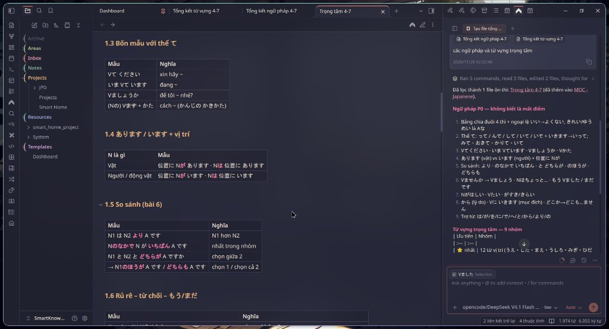

# Twilight Bento — Obsidian Theme

**Twilight Bento** is a clean, low-glare Obsidian theme combining a **1-Viewport Bento Dashboard** (`cssclasses: dashboard-v4`), native **Obsidian Bases** styling (`Calendar`, `KanbanProjects`), **8 modular reading & writing enhancements**, and **13 curated Dark & Light color palettes** via **Style Settings**.

## Highlights

- **1-Viewport Laptop Bento Dashboard (`cssclasses: dashboard-v4`):** Compact top action bar, FullCalendar `Projects.base#Calendar`, Urgent Tasks, `Projects.base#KanbanProjects`, and Quick Notes index cards.
- **13 Curated Color Palettes (switchable in *Style Settings*):**
  - **Dark Mode (8 palettes):**
    - `ITS Dark` *(ITS Theme — Midnight `#070b11` & Crimson `#aa3333`)* — default
    - `Twilight Sunset` *(Dusk Indigo `#282a3a` & Sunset Orange `#e88358`)*
    - `Catppuccin Mocha` *(AnuPpuccin — `#1e1e2e` & Mauve `#cba6f7`)*
    - `Rosé Pine` *(AnuPpuccin — `#191724` & Rose/Gold `#ebbcba` / `#f6c177`)*
    - `Dracula` *(AnuPpuccin — `#282a36` & Purple/Pink `#bd93f9` / `#ff79c6`)*
    - `Tangerine Dunes` *(ITS Theme — Deep Charcoal `#1c1917` & Tangerine `#e67e22`)*
    - `Topaz Nord` *(Blue Topaz — `#2e3440` & Frost `#88c0d0`)*
    - `Hazelnut Chocolate` *(Blue Topaz — `#261c18` & Caramel `#d49b6a`)*
  - **Light Mode (5 palettes):**
    - `Fieldline Archival Paper` *(Ivory `#efeae0` & Charcoal `#23201c`)* — default
    - `Catppuccin Latte` *(AnuPpuccin — `#eff1f5` & Blue `#1e66f5`)*
    - `Everforest Light` *(AnuPpuccin — `#fdf6e3` & Forest `#8da101`)*
    - `Honey Milk` *(Blue Topaz — `#fbf5e9` & Honey `#d48c2a`)*
    - `School Days` *(ITS Theme — Cream `#f7f3e8` & Ink Blue `#2b5b84`)*
- **Built-in Reading & Writing Modules (`.dashboard-v4` safely excluded):**
  - Vertical indent lines for nested lists
  - PDF dark mode tint/inversion
  - Image flags (`|left`, `|right`, `|center`, `|banner`) + click-and-hold image zoom
  - Floating `> [!aside]` margin notes
  - Frosted backdrop for Command Palette & Empty Tab
  - Compact `![[Embed]]` + `> [!infobox]`, `> [!timeline]`, `> [!column]` callouts
  - Colored **Bold** / *Italic* + floating Find & Status pills
  - 28 custom checkbox states (`[/]`, `[>]`, `[-]`, `[!]`, `[?]`, `[i]`, `[*]`, ...)

## Installation

1. Copy `theme.css` and `manifest.json` into `<your-vault>/.obsidian/themes/Twilight Bento/` (or install via **BRAT**).
2. In Obsidian: **Settings → Appearance → Themes → Twilight Bento**.
3. Install **Style Settings** from Community Plugins to switch between all 13 Dark & Light palettes.
4. *(Optional)* Copy `examples/Dashboard.md` and `examples/Projects.base` to use the 1-viewport Bento Dashboard.

## Credits

- Base theme architecture: **Things** by [@colineckert](https://twitter.com/colineckert) (MIT)
- Image adjustments, click-hold zoom, aside & ITS Dark / Tangerine Dunes / School Days palettes: **ITS Theme** by [SlRvb](https://github.com/SlRvb/Obsidian--ITS-Theme)
- Custom checkboxes, emphasis & Catppuccin / Rosé Pine / Dracula / Everforest palettes: **AnuPpuccin** by [AnubisNekhet](https://github.com/anubisnekhet/AnuPpuccin)
- Vertical list lines, PDF dark tint & Topaz Nord / Hazelnut Chocolate / Honey Milk palettes: **Blue Topaz** by [WhyI & Pkmer](https://github.com/PKM-er/Blue-Topaz_Obsidian-css)
